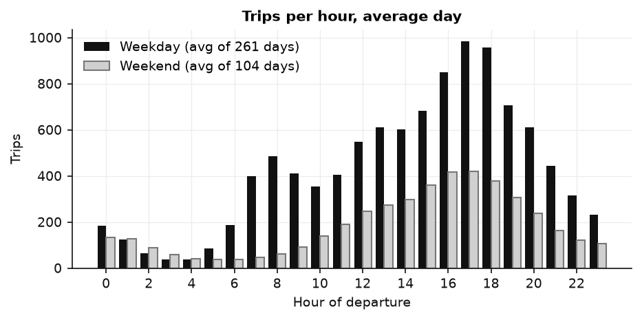
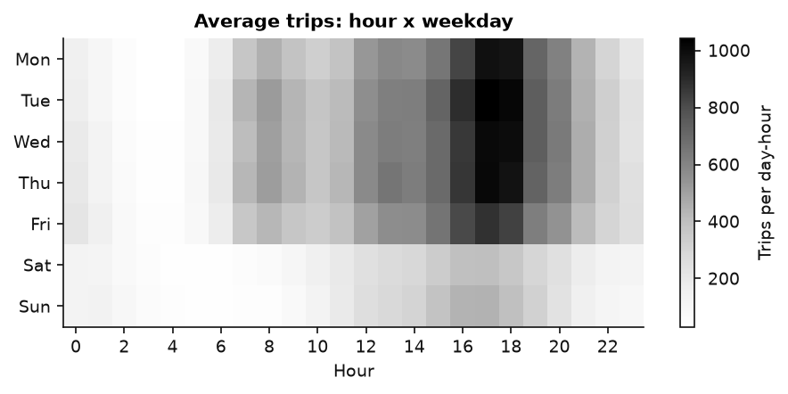
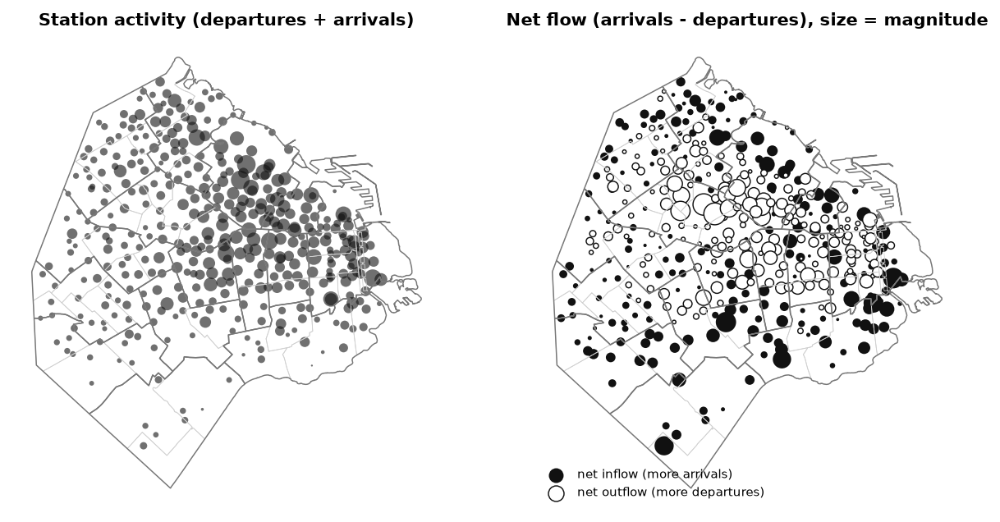
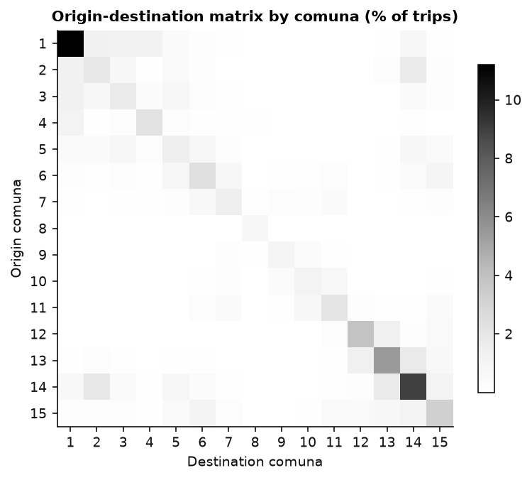
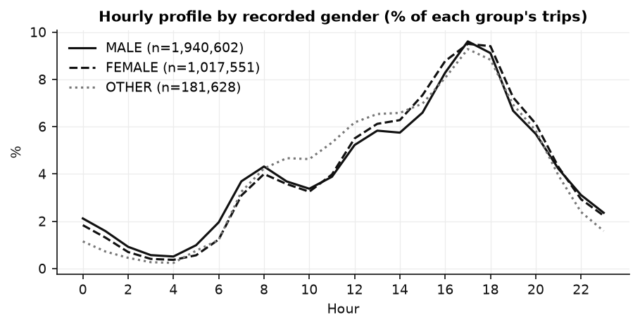
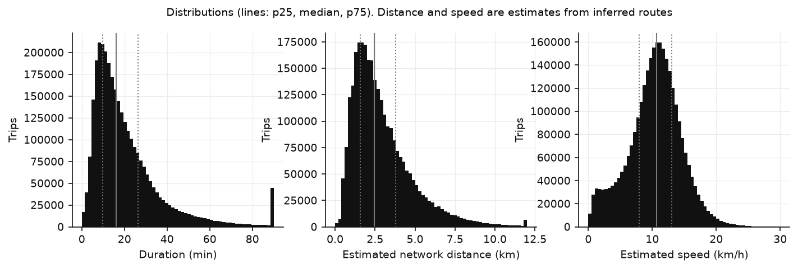
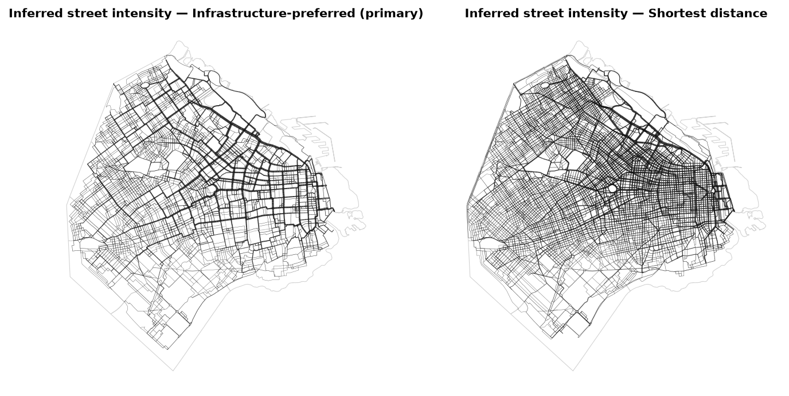
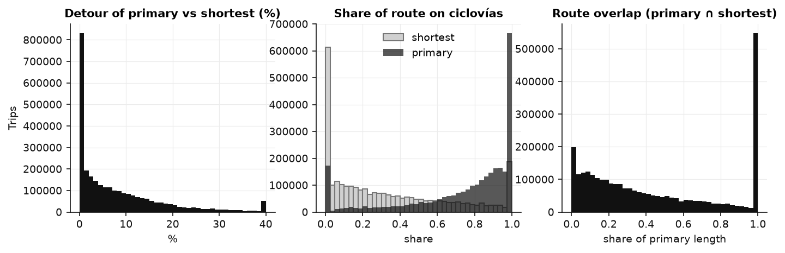

# Exploratory data analysis

Scripts that explore the cleaned 2025 data and save figures to [`figures/`](figures/). Run them **after** the pipeline (`pipeline/01`–`07`):

```bash
cd eda
python 01_temporal.py        # hour, weekday, month, hour x weekday, daily series
python 02_spatial.py         # station activity and net flow, comuna OD matrix, top relations
python 03_users_dds.py       # gender, age, distance / duration / speed distributions
python 04_routing_streets.py # routing strategies, street intensity, OSM comparison
```

Shared plotting style and loaders are in `_style.py` (monochrome palette).

## Key findings (2025, 3,148,375 valid trips)

**Time**
- Weekday commuting pattern: peaks at **08:00** and **17:00**. An average weekday has 2.4× the trips of an average weekend day.
- **October** is the busiest month and **June** the quietest; the monthly averages vary with a coefficient of variation of 0.21.
- Several days have unusually low activity (17 May: 543 trips; 14 June: 564; 19 Aug: 717; 31 Aug: 1,083) compared with a typical ~8,600. **The cause is not verified** (weather or service interruptions are plausible). These days are kept in the data.




**Space**
- 48.6 % of trips start and end in the same comuna; 31.4 % in the same barrio. 8.7 % are round trips (same station).
- Comunas 1 and 14 generate the most trips (≈ 0.52 M departures each). Per resident (2010 census), Comuna 1 and 14 lead with ≈ 3,300 trip-ends per 1,000 residents; Comuna 8 is lowest (176).
- Net flows are small at comuna level (|net| < 1.5 % of departures) but clear at station level: stations in Palermo / central areas lose bikes and southern and riverside stations gain them.




**Users** (categories as recorded; age only for the 93.6 % of trips matched to user files)
- Recorded gender: 61.6 % MALE, 32.3 % FEMALE, 5.8 % OTHER, 0.3 % not recorded.
- Median duration is longer for trips recorded as FEMALE (17.8 min) than MALE (15.2 min). The median estimated speed is 9.7 vs 11.1 km/h. **These are descriptive differences**, not adjusted for distance, purpose or route choice.



**Distance, duration, speed** (estimated, from inferred routes)
- Median duration 16.1 min (p25–p75: 9.8–26.4); median estimated network distance 2.5 km; median estimated speed 10.6 km/h.
- Weekend trips are longer (median 2.9 vs 2.4 km) and slower (8.6 vs 10.9 km/h), which is consistent with leisure riding.
- 665 trips imply over 35 km/h on the inferred route and are excluded from distance and speed statistics.



**Streets** (inferred, **not GPS**)
- With the infrastructure-preferred assumption, 78.5 % of segment-trips fall on ciclovías, and Av. del Libertador carries the highest inferred volume.
- The street map depends on the routing assumption: the primary and shortest routes overlap by only 45 % of their length. An independent OSM bicycle-profile router agrees with the primary strategy within 0.5 % (median route length, top 500 pairs).



